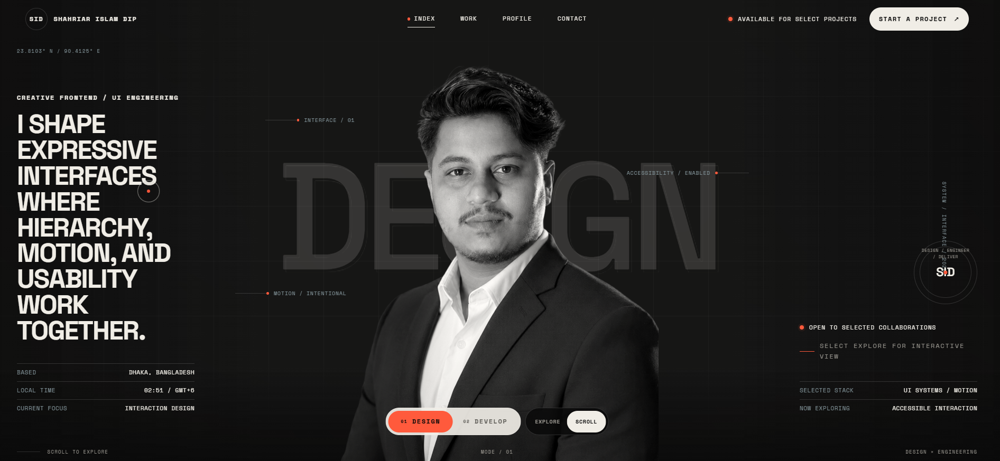

# Shahriar Islam Dip — Creative Full-Stack Developer Portfolio

> **Expressive design meets reliable engineering.**  
> A production-ready, accessible, and motion-considered portfolio showcasing three self-directed digital products and a structured creative process.

---

## 🎯 Overview

This is the personal portfolio of **Shahriar Islam Dip** — a Computer Science and Engineering student at **Independent University, Bangladesh (IUB)** and a creative full-stack developer building expressive, high-performance digital products for startups, premium brands, founders, agencies, and product teams.

**Current focus:** Creative frontend development, UI engineering, full-stack applications, integrations, and product performance.  
**Availability:** Open to selected freelance and collaborative projects.  
**Location:** Dhaka, Bangladesh — available for remote collaboration worldwide.

---

## 📸 Preview



*Hero section with dual-mode selector, interactive portrait reveal, and liquid WebGL background*

---

## ✨ Key Features

| Feature | Description |
|---------|-------------|
| **Dual Portfolio Modes** | Toggle between **Design** and **Develop** perspectives — content, terminology, and focus adapt dynamically |
| **Interactive Hero** | Portrait reveal animation, mode selector, and two interaction modes: *Explore* (cursor-driven) and *Scroll* (traditional) |
| **Liquid Background** | WebGL-powered organic background (`liquid-background.js`) — respects `prefers-reduced-motion` |
| **Smooth Scroll** | Lenis-powered smooth scrolling with ScrollTrigger integration |
| **Project Case Studies** | Three self-directed products with filterable grid, detailed dialogs, and keyboard navigation |
| **Process Navigator** | 7-stage interactive timeline: Discover → Define → Design → Engineer → Test → Launch → Improve |
| **Skills Tab System** | Five expertise areas with dynamic content: Creative Frontend, UI Engineering, Full-Stack, Performance, Integrations |
| **Statement Orbital** | Circular text animation with scroll-linked portrait reveal |
| **Full Accessibility** | Semantic HTML, ARIA attributes, keyboard navigation, focus management, reduced-motion support, skip links |
| **No-JS Fallbacks** | All critical content readable without JavaScript via `<noscript>` blocks |
| **Custom Cursor** | Context-aware cursor with labeled states (OPEN, EXPLORE, SCROLL, REVEAL, FILTER, STEP, CONTACT, CLOSE, PREV, NEXT, TOP, COPY, CONNECT, MENU) |

---

## 🛠 Tech Stack

| Category | Technologies |
|----------|--------------|
| **Core** | HTML5, CSS3 (custom properties, container queries), Vanilla ES6+ JavaScript |
| **Animation** | GSAP 3.13 + ScrollTrigger |
| **Smooth Scroll** | Lenis 1.3 |
| **Fonts** | Inter, Space Grotesk, Space Mono (Google Fonts, preloaded) |
| **Architecture** | Single-page, modular CSS/JS, data-attribute hooks, zero build step |
| **Performance** | Preloaded hero assets, lazy-loaded images, `decoding="async"`, resource hints |
| **Accessibility** | WCAG 2.1 AA target, semantic landmarks, live regions, focus trapping in dialogs |

---

## 📁 Project Structure

```
The_Portfolio/
├── index.html              # Main HTML document (semantic, accessible, SEO-ready)
├── style.css               # Complete design system + component styles
├── script.js               # Core portfolio logic (modes, interactions, dialogs, filters)
├── liquid-background.js    # WebGL liquid background effect
├── favicon/
│   ├── SID.png             # Favicon (32×32)
│   ├── github.png          # Social icons
│   ├── Linkdin.png
│   └── gmail.png
├── images/
│   ├── developer-placeholder.png   # Hero portrait (1067×1402)
│   ├── socialpage.png              # Statement section portrait (1122×1402)
│   ├── screenshotPortfolio.png     # Portfolio preview screenshot
│   └── projects/
│       └── BizStudio.png           # BizGuide AI case study image (1895×905)
└── README.md               # This file
```

> **Note:** No build tooling, bundlers, or package managers required. Open `index.html` directly or serve via any static server.

---

## 🚀 Getting Started

### Quick Preview
```bash
# Option 1: VS Code Live Server (recommended)
# Right-click index.html → "Open with Live Server"

# Option 2: Python
python -m http.server 8080

# Option 3: Node (serve)
npx serve .

# Option 4: PHP
php -S localhost:8080
```
Then open `http://localhost:8080` in your browser.

### Requirements
- Modern browser with ES6+ and WebGL support
- No server-side dependencies

---

## 📖 Section Breakdown

### 1. Hero (`#home`)
- **Portrait reveal** — canvas-based grayscale→color transition on scroll/interaction
- **Mode selector** — Design / Develop tabs (persists in `data-portfolio-mode` on `<body>`)
- **Interaction controls** — Explore (cursor-driven depth) vs Scroll (traditional)
- **Dynamic content** — Kicker, statement, focus, technology, and background word update per mode
- **Annotations** — Five labeled callouts (Interface, Accessibility, Motion, Build, Latency)

### 2. Profile (`#profile`)
- **Identity statement** — "I build digital products that look distinctive, feel effortless, and work consistently and reliably."
- **Education story** — IUB Computer Science & Engineering, framed as system-thinking foundation
- **Three outcomes** — Think with structure, Build with people, Learn beyond class
- **Notes grid** — 7 cards: Experience focus, Selected capabilities (mode-aware), Working philosophy, Currently, Availability, Location, Preferred work

### 3. Expertise (`#skills`)
- **Focus meter** — Visual percentage (design-mode: 88% Creative Frontend)
- **Skill panel** — Dynamic content per tab (title, description, technologies, outcome)
- **Five tabs** — Creative Frontend, UI Engineering, Full-Stack, Performance, Integrations
- **Keyboard navigable** — Arrow keys, Home/End, Enter/Space activation

### 4. Selected Work (`#work`)
- **Three self-directed products:**
  1. **BizGuide AI** — Bangladesh-first business planning product (Full-Stack)
  2. **CareCompass** — Healthcare discovery & appointment booking platform (Full-Stack)
  3. **gocart** — Immersive 3D commerce experience (Experiment/Frontend)
- **Filter tabs** — All, Frontend, Full-stack, Experiments
- **Project dialog** — Case study with overview, challenge, approach, implementation, outcome, technologies, live/source links, gallery, prev/next navigation
- **No-JS fallback** — Static list in `<noscript>`

### 5. Process (`#process`)
- **7-stage timeline** — Discover, Define, Design, Engineer, Test, Launch, Improve
- **Interactive navigator** — Click/keyboard to view stage details (activities, output)
- **Progress indicator** — Visual step progress bar
- **No-JS fallback** — Ordered list

### 6. Statement (`#statement`)
- **Orbital text** — "DESIGN WITH INTENT — ENGINEER WITH PRECISION — SHIP WITH CONFIDENCE —" on SVG circular path
- **Scroll-linked portrait** — Image reveal tied to scroll position
- **Accessible text alternative** — Plain text version for screen readers

### 7. Contact (`#contact`)
- **Email** — `dipshahriar27@gmail.com` (mailto with subject prefill)
- **Copy email button** — Clipboard API with toast feedback
- **Social links** — GitHub, LinkedIn, Email (external, `rel="noopener noreferrer"`)
- **Metadata** — Location, response time, preferred work, local time
- **Marquee** — Decorative scrolling text

### Footer
- **Colophon** — "Designed with intent. Engineered with care."
- **Navigation** — Quick links to all sections
- **Availability + local time** — Dynamic
- **Social icons** — GitHub, LinkedIn, Email
- **Copyright** — Auto-year via `data-current-year`

---

## ⚙️ Customization Guide

### Update Personal Info
| Location | What to Change |
|----------|----------------|
| `<title>`, `<meta property="og:*">` | Site title, description, social preview image |
| `hero__kicker`, `hero__details`, `hero__content--right` | Hero kicker, location, focus, stack |
| `about-education__story` | University, degree, narrative |
| `about-notes` | Experience, capabilities, philosophy, availability |
| `contact-email`, `mailto:` links | Email address |
| Social links (`href`) | GitHub, LinkedIn profiles |
| `data-current-year` (2 locations) | Current year (or use JS to auto-update) |

### Add/Modify Projects
Edit the **project data object** in `script.js` (look for `projectData` or similar). Each project needs:
```javascript
{
  id: 'bizguide-ai',
  number: '01',
  type: 'Self-directed project',
  caseType: 'Full-Stack',
  title: 'BizGuide AI',
  year: '2026',
  role: 'Product Design / Full-Stack Development',
  image: 'images/projects/BizStudio.png',
  imageAlt: 'Descriptive alt text',
  liveUrl: 'https://...',        // optional
  repoUrl: 'https://...',        // optional
  overview: '...',
  challenge: '...',
  approach: '...',
  implementation: '...',
  result: '...',
  technologies: ['Next.js', 'TypeScript', 'Tailwind', 'Supabase', '...'],
  gallery: [                     // optional additional images
    { src: '...', alt: '...' }
  ]
}
```
Then add corresponding filter classes in HTML (`data-project-filter`).

### Modify Skills
Update the **skills data** in `script.js`. Each skill tab needs:
```javascript
{
  id: 'creative-frontend',
  label: 'Design-focused practice',
  title: 'Creative Frontend',
  description: '...',
  technologies: ['HTML', 'CSS', 'JavaScript', 'React', 'Next.js', 'Motion'],
  outcome: 'Interfaces that feel distinctive without sacrificing usability or performance.',
  focusPercent: 88  // design mode
}
```

### Adjust Process Stages
Modify **process data** in `script.js`:
```javascript
{
  index: '03',
  label: 'Experience',
  title: 'Design',
  description: 'Shape the visual system, responsive layouts, interaction language, and reusable interface patterns.',
  activities: [
    'Design system & component library',
    'Responsive layout architecture',
    'Interaction & motion specifications',
    'Accessibility annotations',
    'Design QA & handoff'
  ],
  output: 'Figma design system, annotated prototypes, component specs, motion guidelines, accessibility checklist.'
}
```

### Theme & Design Tokens
All visual tokens live in `style.css` under `:root`:
- **Colors** — `--color-bg`, `--color-fg`, `--color-muted`, `--color-accent`, `--color-border`, `--color-focus`
- **Typography** -- `--font-sans`, `--font-display`, `--font-mono`, fluid type scale `--fs-*`
- **Spacing** — `--space-*` (4px base unit)
- **Radius** — `--radius-*`
- **Shadows** — `--shadow-*`
- **Transitions** — `--transition-*`
- **Z-index** — `--z-*`

### Reduce Motion
The portfolio respects `@media (prefers-reduced-motion: reduce)`:
- Liquid background pauses
- GSAP animations disable
- Lenis smooth scroll disables
- Orbital animation pauses
- All transitions instant

---

## ♿ Accessibility Checklist

- [x] Semantic HTML5 landmarks (`header`, `nav`, `main`, `section`, `footer`, `dialog`)
- [x] Skip link to main content
- [x] ARIA labels, roles, and live regions (`aria-live`, `aria-atomic`, `aria-labelledby`)
- [x] Keyboard navigation for all interactive elements (tabs, dialogs, filters, carousel)
- [x] Focus management (trapping in dialog, restoration on close)
- [x] Sufficient color contrast (WCAG AA)
- [x] `prefers-reduced-motion` honored globally
- [x] Meaningful image `alt` text (empty `alt=""` for decorative)
- [x] `<noscript>` fallbacks for all dynamic content
- [x] Form labels and button accessible names
- [x] Heading hierarchy (h1 → h2 → h3)

---

## 📦 Deployment

### Static Hosting (Recommended)
| Platform | Command |
|----------|---------|
| **Netlify** | Drag & drop folder, or connect Git repo |
| **Vercel** | `vercel deploy` or Git integration |
| **GitHub Pages** | Push to `gh-pages` branch or use Actions |
| **Cloudflare Pages** | Connect repo, build command: `none`, output: `/` |
| **Firebase Hosting** | `firebase deploy` (configure `public: "."`) |
| **Surge.sh** | `surge . your-domain.surge.sh` |

### Custom Domain
1. Add `CNAME` file with your domain (or configure in host dashboard)
2. Update `<link rel="canonical">` and `<meta property="og:url">` in `index.html`
3. Replace `[SOCIAL PREVIEW IMAGE URL]` with actual OG image

### Performance Checklist (Pre-deploy)
- [ ] Compress images (WebP/AVIF, appropriate dimensions)
- [ ] Enable gzip/brotli on server
- [ ] Set long-term caching for static assets (`Cache-Control: public, max-age=31536000, immutable`)
- [ ] Verify no console errors
- [ ] Run Lighthouse (target: Performance ≥ 90, Accessibility ≥ 95, Best Practices ≥ 90, SEO ≥ 90)

---

## 🔧 Development Notes

### Adding New Sections
1. Add semantic `<section>` in `index.html` with `id`, `aria-labelledby`
2. Add navigation link in header + mobile menu + footer
3. Add styles in `style.css` (follow existing patterns: `section-name`, `section-name__element`)
4. Add reveal attributes (`data-reveal="fade-up|clip"`, `data-speed`)
5. Initialize any JS in `script.js` (intersection observers, interactions)

### JavaScript Architecture
- **No framework** — vanilla ES6 modules pattern (IIFE or top-level `const`)
- **Data-attribute hooks** — `data-*` for all JS selectors (no class-based JS hooks)
- **Single initialization** — `DOMContentLoaded` → `init()` orchestrates modules
- **State** — Minimal, stored on elements or module-scoped variables
- **Events** — Delegated where possible, passive listeners for scroll

### CSS Methodology
- **BEM-ish** — Block `__element` `--modifier`
- **Custom properties** — All tokens in `:root`, component-scoped where needed
- **Container queries** — Used for component-level responsiveness
- **Fluid typography** — `clamp()` for all font sizes
- **Logical properties** — `inline-size`, `block-size`, `margin-inline`, etc.

---

## 📄 License

This portfolio is **personal work** — not licensed for reuse as a template.  
You may reference the code for learning purposes.  
All project case studies, images, and written content are proprietary.

---

## 🤝 Contact & Links

| Channel | Link |
|---------|------|
| **Email** | [dipshahriar27@gmail.com](mailto:dipshahriar27@gmail.com) |
| **GitHub** | [github.com/Eldorado10](https://github.com/Eldorado10?tab=repositories) |
| **LinkedIn** | [linkedin.com/in/mr-eldorado-536900229](https://www.linkedin.com/in/mr-eldorado-536900229/) |
| **Portfolio** | [Live Site](#) *(deploy to get URL)* |

> **Response time:** Typically within 30 minutes during business hours (GMT+6).  
> **Preferred work:** Interactive websites, product interfaces, business platforms, design-led web applications.

---

## 🙏 Acknowledgments

- **GSAP** — GreenSock Animation Platform
- **Lenis** — Studio Freight smooth scroll
- **Google Fonts** — Inter, Space Grotesk, Space Mono
- **Inspiration** — Design-engineering hybrid portfolios that respect craft and code equally

---

*Built with intent. Engineered with care. Shipped with confidence.*  


**— Shahriar Islam Dip, 2026**